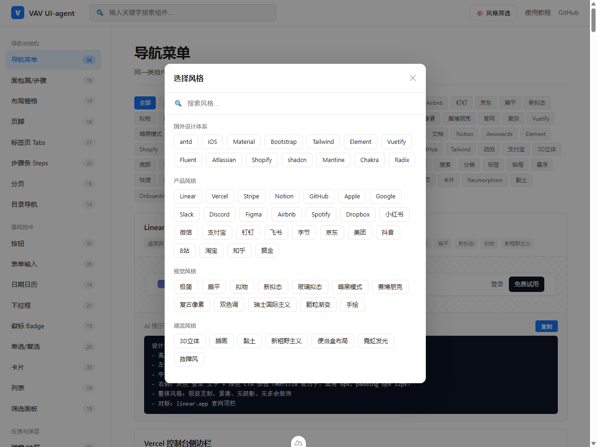

# VAV UI-agent

> 28 类 UI 组件、700+ 个可直接复制的 AI 提示词变体。按「组件分类 + 产品风格」整理好，挑一个对得上眼的，把提示词丢给 AI 就能生成代码。

**在线演示**：<https://ui.vavagent.com/>




## 这是什么

做网站或 App 时，同一个功能（导航栏、按钮、表格、弹窗……）有很多种实现方式。问题通常不是"不会写"，而是**不知道有多少种可选、也不知道怎么跟 AI 描述清楚**。

这个项目把常见 UI 组件按分类拆开，每个分类下收录同一组件在不同产品形态中的真实变体：

- 每个变体都有**可直接渲染的 HTML 预览**，不是截图；
- 每个变体都配了一段**结构化提示词**：颜色值、尺寸、圆角、间距、hover/active 状态，末尾注明参考产品（Linear / Vercel / Ant Design……）；
- 点「复制」就能直接投喂给 ChatGPT、Claude、豆包这类模型。

目标是少一点"做个导航栏"式的模糊需求，多一点"深色底 #0a0a0a、240px 宽、hover 左侧 2px 蓝色竖条"这种能落地的描述。

## 功能

- **每个变体都有详情页**：`/v/card-001/` 这类独立页面，预览可切 375 / 768 / 自适应三档宽度，先把手机宽度的问题暴露出来再决定用不用
- **三种粒度的提示词**：改造模板（改现有页面，只动样式不动结构，要求 AI 先给 2-3 个方向）／原始设计说明（从零做）／一句话（快速试）
- **给 AI 直接读的出口**：`/catalog.md`（全库目录）、`/api/v/<slug>.md`（单变体 Markdown，丢链接给 AI 就会读）、`/search.json`（约 175KB 的精简索引）
- **700+ 个变体 / 28 个分类**，分四大组：导航与结构、基础控件、反馈与弹层、数据展示
- **风格筛选**：70+ 风格标签，按国外设计体系（antd / iOS / Material / Tailwind / shadcn…）、产品风格（Linear / Vercel / Stripe / Notion / 小红书 / 飞书 / 淘宝…）、视觉风格（极简 / 玻璃拟态 / 赛博朋克 / 新粗野主义…）、潮流风格（3D 立体 / 黏土 / 故障风…）四组收纳
- **关键词搜索**：同时匹配组件名、描述和提示词正文
- **视图状态全在 URL 里**：`?cat=nav&tag=Linear&q=侧边栏`，分享链接即可还原同一屏
- **零 UI 框架**：手写 CSS + CSS 变量，没有引入 Tailwind 或组件库，方便整套换肤
- **零后端**：`nuxt generate` 出纯静态文件（`index.html` / `guide/` / `filter/` / `catalog.json`），任意静态托管、CDN 或对象存储都能直接跑，不需要 Node、数据库或服务端进程
- **自带访问统计**：轻量埋点（`/collect.gif` + nginx 日志 + 定时汇总），`/stats` 看板能看到今日 PV/UV、最近 14 天趋势、热门分类、被浏览/被复制最多的变体、搜索词与风格标签偏好；不接第三方统计、不用 Cookie

## 技术栈

| 层 | 选型 |
| --- | --- |
| 框架 | Nuxt 3（SSG：`nuxt generate` 出纯静态站） |
| UI | Vue 3 + 手写 CSS（`assets/css/main.css` + 页面 scoped style） |
| 数据 | 构建期由 `scripts/make-catalog.mjs` 从快照导出 `catalog.json`，页面加载后本地筛选 |
| 语言 | TypeScript |

## 快速开始

要求 Node.js >= 20（开发时使用 v22）。

```bash
git clone https://github.com/vavagent/vav-ui-agent.git
cd vav-ui-agent
npm install
npm run dev      # http://localhost:3210
```

构建静态站与本地预览：

```bash
npm run generate   # 生成 .output/public（纯静态）
npx serve .output/public -l 3210
```

`npm run dev` / `npm run generate` 都会先执行 `scripts/make-catalog.mjs`，把 `server/database/seed-snapshot.json` 导出成 `public/catalog.json`（28 分类 / 702 变体 / 643KB），页面拿这份数据在浏览器里完成分类、搜索和标签筛选。

`server/database/index.ts` 保留着 SQLite 版本的取数实现（SSR 模式或自建 API 时可复用），静态站不依赖它，也不需要数据库文件。

## 目录结构

```
.
├─ app.vue                      # 挂载 NuxtPage
├─ nuxt.config.ts               # 站点标题、全局样式、预渲染路由（/、/guide、/filter）
├─ scripts/
│  ├─ make-catalog.mjs          # 快照 → public/catalog.json（构建期数据导出）
│  ├─ make-favicon.py           # 生成 favicon / PWA 图标
│  ├─ stats-aggregate.py        # nginx 埋点日志 → stats.json（服务器 cron 每 5 分钟）
│  └─ deploy.py                 # 本地生成静态站 → 上传服务器 → 切软链接 → 探活
├─ composables/useTrack.ts      # 埋点上报（/collect.gif）
├─ plugins/track.client.ts      # PV 采集
├─ assets/css/main.css          # CSS 变量与基础样式
├─ pages/
│  ├─ index.vue                 # 素材库主界面：分类侧栏 / 搜索 / 标签筛选 / 预览 / 复制
│  ├─ v/[slug].vue              # 变体详情页：响应式预览（375/768/自适应）+ 三种粒度提示词
│  ├─ filter.vue                # 电商风格筛选面板的独立示例
│  ├─ stats.vue                 # 数据看板（今日 PV/UV、热门分类、浏览/复制榜、搜索词）
│  └─ guide.vue                 # 使用教程（选组件 → 挑变体 → 复制提示词）
├─ server/
│  ├─ api/
│  │  ├─ catalog.get.ts         # 构建期读取 catalog.json，把数据写进页面 payload
│  │  ├─ variant.get.ts         # 构建期读取单个变体 JSON（详情页预渲染用）
│  │  ├─ categories.get.ts      # 分类列表（SSR 模式备用）
│  │  └─ components.get.ts      # 组件列表（SSR 模式备用）
│  └─ database/
│     ├─ index.ts               # SQLite 初始化、建表、种子装载（SSR 模式备用）
│     └─ seed-snapshot.json     # 全量数据快照（28 分类 / 700+ 组件），唯一数据源
├─ home.png / modal.png         # README 截图
└─ LICENSE                      # MIT
```

## 数据模型与筛选

数据源只有一个文件：`server/database/seed-snapshot.json`。

| 字段 | 类型 | 说明 |
| --- | --- | --- |
| `cat` | string | 所属分类，对应 `categories.slug` |
| `name` | string | 变体名称，如「Linear 风格顶部导航」 |
| `desc` | string | 一句话说明 |
| `tags` | string | JSON 数组字符串，风格/形态标签，如 `["桌面端","Linear","极简"]` |
| `preview` | string | 预览用的 HTML 片段，由页面 `v-html` 渲染 |
| `prompt` | string | 可直接复制的 AI 提示词 |
| `sort` | number | 同分类内排序 |

构建时 `scripts/make-catalog.mjs` 把它整理成四类产物：

| 产物 | 内容 | 用途 |
| --- | --- | --- |
| `public/catalog.json` | `groups` + `components`（含 `slug`、`prompt`、`prompt_short`、`preview_html`） | 首页一次加载、本地筛选 |
| `public/search.json` | 分类 + 变体的 slug / 名称 / 标签 / 一句话（约 175KB） | 给 AI 或脚本按需检索，不用拉全量 |
| `public/catalog.md` | 全库目录的 Markdown 版 | AI 一次读完就知道有什么 |
| `public/api/v/<slug>.json`、`.md` | 单个变体完整数据与 Markdown 版 | 详情页按需取；Markdown 直接丢给 AI |

`slug` 规则：分类内按 `sort` 编号，形如 `card-001`、`nav-037`，稳定、可分享、可被 AI 引用。

页面用一次 `useAsyncData('catalog')` 把整份数据读进来（构建期走 `/api/catalog` 写进 payload，运行时走 `/catalog.json`），之后分类切换、关键词搜索、标签筛选全部在浏览器本地完成：

- `q` 同时匹配 `name`、`description`、`prompt`（小写包含）；
- `tag` 精确匹配 `tags` 数组元素；
- 视图状态仍在 URL 里：`?cat=nav&tag=Linear&q=侧边栏`。

### 新增一个组件变体

1. 在 `server/database/seed-snapshot.json` 里加一条（`sort` 决定位置）；
2. `npm run generate` 重新生成静态站（`catalog.json` / `search.json` / `catalog.md` / 详情页都会自动更新）；
3. 按 [docs/DEPLOY.md](./docs/DEPLOY.md) 第 7 节发版。

静态站没有写入接口，内容改动都要走「改快照 → 重新构建 → 发版」这条路。

## 给 AI 直接读

参照 21st.dev 那种「把链接丢给 AI，它自己读完再动手」的用法，本站每个变体都有纯 Markdown 出口：

```text
https://ui.vavagent.com/catalog.md              全库目录（28 分类 / 702 变体）
https://ui.vavagent.com/api/v/card-001.md       单个变体：设计说明 + 一句话 + 改造模板
https://ui.vavagent.com/search.json             精简索引，脚本/agent 按标签筛
```

Markdown 由 nginx 以 `text/markdown` 返回，可以直接作为工具结果喂给模型。配合「改造模板」使用，典型流程是：

1. 让 AI 读 `catalog.md` 或 `search.json`，按「我要做定价页 / Linear 风格」筛出 2-3 个候选；
2. 你确认后，让它读那一个的 `/api/v/<slug>.md`；
3. 用里面的「改造模板」约束它：只改样式、不动数据结构、先给方向再出代码。

> MCP server（本地 stdio）还在路线图上，用来把这个流程收成一条命令。

### 提示词写法约定

页面里给出的公式是：

```
组件类型 + 具体参数（颜色 / 尺寸 / 圆角 / 间距）+ 参考风格（哪个产品）+ 状态（hover / active / disabled）
```

对照 `seed-snapshot.json` 里的 `prompt` 字段就能看到落地示例。

## 开源与协作

完整的开源流程（自检清单、建仓、推送、仓库设置、发版、维护节奏）见 [docs/OPEN-SOURCE.md](./docs/OPEN-SOURCE.md)；贡献方式见 [CONTRIBUTING.md](./CONTRIBUTING.md)。

## 许可

[MIT](./LICENSE)。`seed-snapshot.json` 里的品牌名（Linear、Vercel、Ant Design 等）仅用于描述风格取向，项目与这些公司无关联，也不包含其商标素材。
