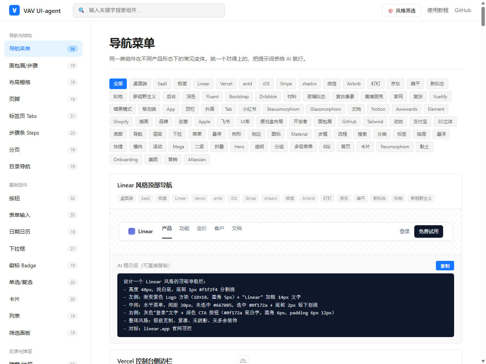

# VAV UI-agent

> 28 类 UI 组件、700+ 个可直接复制的 AI 提示词变体。按「组件分类 + 产品风格」整理好，挑一个对得上眼的，把提示词丢给 AI 就能生成代码。

**在线演示**：<https://ui.vavagent.com/>




## 这是什么

做网站或 App 时，同一个功能（导航栏、按钮、表格、弹窗……）有很多种实现方式。问题通常不是"不会写"，而是**不知道有多少种可选、也不知道怎么跟 AI 描述清楚**。

这个项目把常见 UI 组件按分类拆开，每个分类下收录同一组件在不同产品形态中的真实变体：

- 每个变体都有**可直接渲染的 HTML 预览**，不是截图；
- 每个变体都配了一段**结构化提示词**：颜色值、尺寸、圆角、间距、hover/active 状态，末尾注明参考产品（Linear / Vercel / Ant Design……）；
- 点「复制」就能直接投喂给 ChatGPT、Claude、豆包这类模型。

目标是少一点"做个导航栏"式的模糊需求，多一点"深色底 #0a0a0a、240px 宽、hover 左侧 2px 蓝色竖条"这种能落地的描述。

## 功能

- **700+ 个变体 / 28 个分类**，分四大组：导航与结构、基础控件、反馈与弹层、数据展示
- **风格筛选**：70+ 风格标签，按国外设计体系（antd / iOS / Material / Tailwind / shadcn…）、产品风格（Linear / Vercel / Stripe / Notion / 小红书 / 飞书 / 淘宝…）、视觉风格（极简 / 玻璃拟态 / 赛博朋克 / 新粗野主义…）、潮流风格（3D 立体 / 黏土 / 故障风…）四组收纳
- **关键词搜索**：同时匹配组件名、描述和提示词正文
- **视图状态全在 URL 里**：`?cat=nav&tag=Linear&q=侧边栏`，分享链接即可还原同一屏
- **零 UI 框架**：手写 CSS + CSS 变量，没有引入 Tailwind 或组件库，方便整套换肤
- **开箱即用**：首次启动自动建表，并从快照装载全部 700+ 条数据，不需要额外准备数据库

## 技术栈

| 层 | 选型 |
| --- | --- |
| 框架 | Nuxt 3（SSR，`useFetch` 服务端取数） |
| UI | Vue 3 + 手写 CSS（`assets/css/main.css` + 页面 scoped style） |
| 数据 | better-sqlite3（WAL 模式），单文件库 `data/ui.db` |
| 语言 | TypeScript |

## 快速开始

要求 Node.js >= 20（开发时使用 v22）。

```bash
git clone https://github.com/vavagent/vav-ui-agent.git
cd vav-ui-agent
npm install
npm run dev      # http://localhost:3210
```

构建与本地预览：

```bash
npm run build
npm run preview
```

首次启动时 `server/database/index.ts` 会：

1. 在 `data/` 下创建 `ui.db`（已被 `.gitignore` 排除）；
2. 建 `categories`、`components` 两张表；
3. 检测到空库时，从 `server/database/seed-snapshot.json` 装载 28 个分类、700+ 个组件。

想恢复出厂数据，停掉服务后删掉 `data/ui.db`（连同 `ui.db-shm`、`ui.db-wal`）再启动即可。

## 目录结构

```
.
├─ app.vue                      # 挂载 NuxtPage
├─ nuxt.config.ts               # SSR、站点标题、全局样式入口
├─ assets/css/main.css          # CSS 变量与基础样式
├─ pages/
│  ├─ index.vue                 # 素材库主界面：分类侧栏 / 搜索 / 标签筛选 / 预览 / 复制
│  ├─ filter.vue                # 电商风格筛选面板的独立示例
│  └─ guide.vue                 # 使用教程（选组件 → 挑变体 → 复制提示词）
├─ server/
│  ├─ api/
│  │  ├─ categories.get.ts      # 分类列表（按 grp 分组 + 各分类组件数）
│  │  └─ components.get.ts      # 组件列表（cat / q / tag 三个筛选参数）
│  └─ database/
│     ├─ index.ts               # SQLite 初始化、建表、种子装载
│     └─ seed-snapshot.json     # 全量数据快照（28 分类 / 700+ 组件）
├─ data/ui.db                   # 运行时生成，不提交
├─ home.png / modal.png         # README 截图
└─ LICENSE                      # MIT
```

## 数据模型与 API

`components` 表：

| 字段 | 类型 | 说明 |
| --- | --- | --- |
| `category_slug` | TEXT | 所属分类，对应 `categories.slug` |
| `name` | TEXT | 变体名称，如「Linear 风格顶部导航」 |
| `description` | TEXT | 一句话说明 |
| `tags` | TEXT | JSON 数组字符串，风格/形态标签，如 `["桌面端","Linear","极简"]` |
| `preview_html` | TEXT | 预览用的 HTML 片段，由页面 `v-html` 渲染 |
| `prompt` | TEXT | 可直接复制的 AI 提示词 |
| `sort` | INTEGER | 同分类内排序 |

接口：

| 方法 | 路径 | 参数 | 返回 |
| --- | --- | --- | --- |
| GET | `/api/categories` | — | 按 `grp` 分组后的分类数组，含每类组件数 `count` |
| GET | `/api/components` | `cat`（默认 `nav`）、`q`（关键词）、`tag`（风格标签） | 组件数组，`tags` 已解析为字符串数组 |

`q` 会同时匹配 `name`、`description`、`prompt`；`tag` 用 `tags LIKE '%"标签"%'` 做匹配，数据量在当前规模下够用。

### 新增一个组件变体

- **临时试用**：直接往 `data/ui.db` 的 `components` 表插一行，刷新页面即可看到（`sort` 决定位置）。
- **准备提交**：同时改 `server/database/seed-snapshot.json`，让别人克隆后拿到同样的数据。

> 注意：快照只在 `categories` 表为空时装载。库已经存在时改快照不会生效，需要删除 `data/ui.db` 重建，或手动导入。

### 提示词写法约定

页面里给出的公式是：

```
组件类型 + 具体参数（颜色 / 尺寸 / 圆角 / 间距）+ 参考风格（哪个产品）+ 状态（hover / active / disabled）
```

对照 `seed-snapshot.json` 里的 `prompt` 字段就能看到落地示例。

## 开源与协作

完整的开源流程（自检清单、建仓、推送、仓库设置、发版、维护节奏）见 [docs/OPEN-SOURCE.md](./docs/OPEN-SOURCE.md)；贡献方式见 [CONTRIBUTING.md](./CONTRIBUTING.md)。

## 许可

[MIT](./LICENSE)。`seed-snapshot.json` 里的品牌名（Linear、Vercel、Ant Design 等）仅用于描述风格取向，项目与这些公司无关联，也不包含其商标素材。
